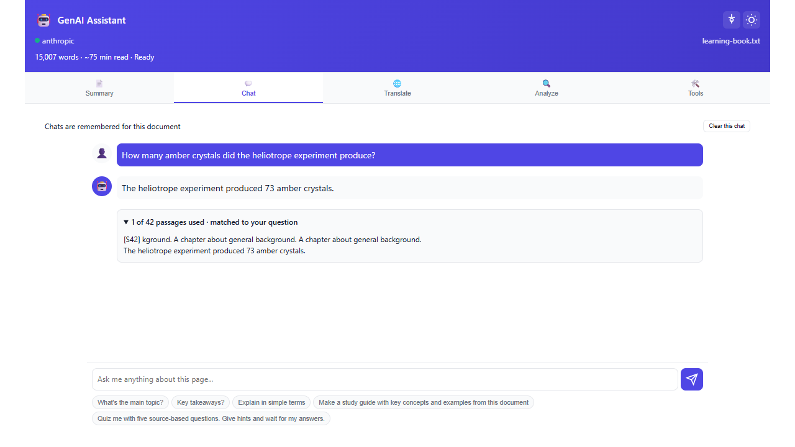

# GenAI Browser Tool

Read a page, ask questions with source passages, and turn it into a study guide
or quiz. This Chrome 116+ extension uses the AI provider and key you choose.
Page text goes directly to that provider; there is no application server or telemetry.



The screenshot uses an intercepted test response; it demonstrates the interface,
not live model quality.

The reading workspace keeps your source beside the tools, with light and dark
themes and a compact popup. Use **Study guide** or **Quiz me** in Chat to start
learning. Navigate task tabs with Left/Right, Home, and End; Tab moves into the
selected panel. Summary length works with native radio-keyboard controls.
See the [interface decisions and verification](docs/product/INTERFACE.md).

## Start here

Clone or download this repository:

```bash
git clone https://github.com/aaron-seq/GenAI-Browser-Tool.git
```

1. Open `chrome://extensions`, enable **Developer mode**, and choose **Load
   unpacked** → the repository root containing `manifest.json`. No build or
   dependency installation is needed to use the extension.
2. In options, select a provider and enter its API key. Fields save automatically.
   **Test connection** optionally sends a small request with the entered key/model.
3. Open an article, click the extension, and check its title and word count.
   Generate a summary or ask a question.
4. Choose **Open workspace** for a persistent reading tab. Import UTF-8 `.txt`
   or `.md` files there; importing alone sends no provider request.
5. In Chat, choose **Study guide** or **Quiz me**, ask follow-up questions,
   and expand the source passages to check the evidence.

Installation is currently unpacked; there is no published Web Store release.

## What works

- **Summary:** four styles and three lengths; matching saved results avoid another
  provider call.
- **Chat:** local keyword retrieval selects up to six passages across the document.
  Answers display source labels and excerpts.
- **Document memory:** restore the latest summary and up to 30 completed exchanges
  for the same URL and unchanged text. **Clear this chat** removes its exchanges.
- **Import:** text/Markdown up to 2,000,000 characters and 8 MB; the same filename
  and text identify a returning imported document.
- **Translate/analyze:** saved language preferences, sentiment, insights, entities,
  and tags. Local tools provide readability, counts, headings, links, and JSON
  export of history/settings without keys.
- **Quick actions:** right-click a page/selection or use `Ctrl+Shift+S`
  (`Command+Shift+S` on Mac) for a quick page summary.

### Long documents and speed

Summaries process up to **eight sections of 24,000 characters**, with three
section requests in flight and a final merge (up to nine requests before retries).
Coverage notices identify omitted text. Translation, other analyses, and quick
actions still use the first 24,000 characters; see [#17](https://github.com/aaron-seq/GenAI-Browser-Tool/issues/17).

Chat uses local BM25 keyword retrieval, not model training. Synonyms, some languages,
and questions requiring every chapter can exceed its recall. The
[retrieval benchmark](docs/product/RESEARCH.md#performance-evidence) does not measure
provider latency or establish instant book comprehension. PDF/EPUB/OCR are
[planned separately](https://github.com/aaron-seq/GenAI-Browser-Tool/issues/26).

## Providers and privacy

Choose Anthropic, OpenAI, or Google and optionally override the model in options.
See [default models and provider evidence](docs/product/RESEARCH.md#provider-selection).
AI requests require your key and may incur charges. Local extraction/statistics
work without one; live account access and answer quality have not been evaluated.

Keys live in `chrome.storage.sync`, which is not an encrypted secret store.
History stays in the browser profile: up to 1,000 summaries and 500 exchanges,
with daily cleanup of entries older than 90 days. **Save history** off disables
new saves, summary-cache reuse, and restoration; it does not erase old records.
Saved answers/source excerpts and JSON exports can contain sensitive text.
Full imported documents and retrieval indexes are not persisted.

Options apply immediately. Disabling context menus removes right-click actions;
the shortcut remains available. Disabling notifications suppresses desktop
notices, including shortcut results; popup/workspace output remains visible.
Unreadable preferences suppress optional notices/history and cannot be replaced
with defaults by an update. If saving fails, copy the visible result before closing.
See [security and data handling](docs/SECURITY.md).

No semantic backend or local model is installed. Optional private retrieval is
[research work](https://github.com/aaron-seq/GenAI-Browser-Tool/issues/27).

## Troubleshooting

| Symptom                        | Next step                                                                                              |
| ------------------------------ | ------------------------------------------------------------------------------------------------------ |
| Missing key / 401 / 403        | Check the selected provider, key, model access, and **Test connection**.                               |
| 429 / provider unavailable     | Check quota. Transient failures retry twice; authentication/configuration errors and timeouts do not.  |
| Cannot read a page             | Browser pages, the Web Store, and PDF viewers are restricted. Reload dynamic pages after installation. |
| Changed page starts a new chat | URL and text identify a document; changed versions start another thread.                               |
| Incomplete summary             | Read the coverage notice; split documents beyond the eight-section cap.                                |
| Settings cannot load           | Reload Settings to retry; do not assume defaults reflect saved choices.                                |
| Update is missing              | Reload the extension at `chrome://extensions`, then reopen its UI.                                     |

## Develop and contribute

Development needs Node >=20.19 and npm >=10:

```bash
npm ci
npm run verify
npx playwright install chromium
npm run test:e2e
```

Browser tests load the actual extension with intercepted provider responses.
See [development](docs/DEVELOPMENT.md) for coverage, audit, benchmark, CI, and
packaging commands, and [contributing](CONTRIBUTING.md) for change/review rules.

[Product brief](docs/product/PRODUCT.md) · [Research](docs/product/RESEARCH.md) ·
[Supplied engineering brief](docs/product/ENGINEERING-BRIEF.md) ·
[Current work](docs/product/PROJECT-STATUS.md) ·
[GitHub issues](https://github.com/aaron-seq/GenAI-Browser-Tool/issues) ·
[Private dashboard](https://github.com/users/aaron-seq/projects/6) · [MIT license](LICENSE)
