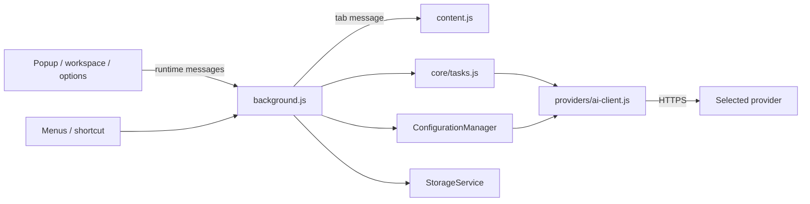

# Development Guide

## Architecture Overview

The repository root is a loadable MV3 extension with no build step or runtime
dependencies. All provider calls originate in the worker; the content script
only reads the page.



A summary extracts page text, checks the saved-result key, then either makes one
request or summarizes up to eight 24,000-character sections (three concurrently)
and merges the notes. Any failed section fails the task; partial results are not
presented as complete. Errors retain their code and message.

## Source map

| Path                            | Responsibility                                                                       |
| ------------------------------- | ------------------------------------------------------------------------------------ |
| `background.js`                 | Synchronously registered listeners, message routing, tasks, menus, commands, cleanup |
| `content.js`                    | Read-only DOM text, metadata, links, images, selection                               |
| `core/configuration-manager.js` | Settings/defaults and construction of the selected client                            |
| `core/tasks.js`                 | Prompts, content fencing, chunking, response parsing                                 |
| `core/document.js`              | Shared document limit and URL/text SHA-256 identity                                  |
| `core/retrieval.js`             | Local BM25 indexing, ranking, source excerpts                                        |
| `providers/ai-client.js`        | Provider wire formats, HTTPS, retries, timeouts                                      |
| `scripts/popup-main.js`         | Popup/workspace, imports, restoration, escaped rendering                             |
| `options.js`                    | Settings UI                                                                          |
| `services/`                     | History persistence and desktop notifications                                        |

Default models and wire formats live in `PROVIDERS`. Selection is explicit:
a missing key is an error, with no scoring or automatic provider fallback.

## Message contract

Extension pages send `{ actionType, requestId, payload }` through
`chrome.runtime.sendMessage`. The optional request ID is echoed.
[Validation](../utils/validation-service.js) requires an object, a nonempty action,
and this extension's sender ID; the [router](../background.js) rejects unknown actions.

| Action                                                            | Input / result                                                                                             |
| ----------------------------------------------------------------- | ---------------------------------------------------------------------------------------------------------- |
| `GENERATE_CONTENT_SUMMARY`                                        | `content`, `summaryType`, `targetLength`; summary and coverage                                             |
| `ANSWER_CONTEXTUAL_QUESTION`                                      | `question`, `context`, optional `conversationHistory`, `url`, `title`; answer, sources, coverage           |
| `TRANSLATE_CONTENT`                                               | `text`, `targetLanguage`, optional `sourceLanguage`                                                        |
| `ANALYZE_SENTIMENT`                                               | `text`; sentiment and reason                                                                               |
| `EXTRACT_KEY_INSIGHTS`, `GENERATE_SMART_TAGS`, `EXTRACT_ENTITIES` | `text`; requested analysis                                                                                 |
| `EXTRACT_PAGE_CONTENT`                                            | `tabId`, falling back to sender tab; extraction                                                            |
| `GET_USER_PREFERENCES`, `UPDATE_USER_PREFERENCES`                 | Read settings or merge a settings payload                                                                  |
| `GET_PROVIDER_STATUS`                                             | Selected provider and configured-key status                                                                |
| `TEST_PROVIDER_CONNECTION`                                        | Entered `provider`, `apiKey`, optional `model`; 16-token request, 10s timeout, no retries; never saves key |
| `GET_DOCUMENT_HISTORY`                                            | `url`, `content`; summary, up to 30 exchanges, `memoryEnabled`                                             |
| `CLEAR_DOCUMENT_CHAT`                                             | `url`, `content`; removes matching exchanges, returns count                                                |
| `GET_HISTORY`                                                     | Saved summaries and conversations                                                                          |
| `EXPORT_USER_DATA`                                                | Schema-v2 settings/history object, excluding API keys                                                      |

Success: `{ success: true, data, requestId, processingTime }`.
Failure: `{ success: false, error, errorCode, requestId, processingTime }`.
Popup messages have no `sender.tab`, so send an explicit tab ID.
The content script separately accepts `{ action: 'extractContent' }`.

## Storage and security

`ConfigurationManager` owns `chrome.storage.sync.user_preferences`:
keys, models, provider, summary/language/theme preferences, and feature flags.
Keys are plaintext at the API level, sync with the browser profile, and are
excluded from exports. Unreadable preferences cannot authorize optional effects
or replacement updates. See [security and data handling](SECURITY.md).

`StorageService` owns local `genai_summary_history` (1,000 entries) and
`genai_conversation_history` (500). A daily alarm prunes entries older than
90 days; entries without timestamps remain. Mutations serialize per key in the
worker, including clear-chat and cleanup. A failed mutation read propagates
instead of overwriting history with an empty list; read-only access retains its
logged fallback.

### Document retrieval, cache, and memory

Identity hashes URL plus trimmed text. Changed text/URLs start another thread;
old unscoped records remain exportable without being restored. Full imports and
indexes are not persisted.

Retrieval selects up to six 2,800-character passages with 200-character overlap.
It uses question and prior user wording; no-match queries sample across the
document. This is lexical retrieval, with no guarantee of semantic or exhaustive
recall. The three-document cache evicts the oldest insertion and disappears on
worker suspension. Restoration returns at most 30 exchanges; prompts use bounded
recent conversation. See [retrieval research](product/RESEARCH.md).

Summary keys include `summary-v1`, document identity, provider, model, style,
and length. Bump the version when summary prompt meaning changes. Save history
off disables saves, cache reuse, and restoration; it does not delete records.
The worker checks the preference again before saving an in-flight result.

Summaries are stored once as `summary`; response `text` is reconstructed.
History/quota failures leave generated summary/chat output visible with a save
warning, without another provider request.

`popup.html?workspace=1&tabId=123` binds a workspace to its source tab; ordinary
popup startup queries the active tab. User-selected UTF-8 text/Markdown imports
validate 8 MB and 2,000,000-character limits. Their identity uses
`local-document:`, filename, and content hash. Extraction/import sends no AI request.

## Local validation

Use Node >=20.19 and npm >=10.

```bash
npm ci
npm run verify
npm run test:coverage
npx playwright install chromium
npm run test:e2e
npm audit --audit-level=high
npm run benchmark:retrieval
```

`verify` runs lint, typecheck, and Vitest. Tests import shipped controllers and
mock Chrome APIs/provider fetches. [Coverage floors](../vitest.config.js) cover
all shipped JavaScript: statements/functions 85%, lines 88%, branches 78%, and
worker branches 75%.

Playwright uses the actual unpacked extension in persistent Chromium contexts,
with intercepted fixture pages/provider responses. A real toolbar click granting
`activeTab` remains a manual release check. These tests do not verify live keys,
model access/quality, native OS notices, or minimum-browser compatibility.

## Pull requests and packaging

[CI](../.github/workflows/ci.yml) runs lint, types, and coverage on Node 20/22/24;
Node 22 also audits dependencies. Browser tests precede packaging.
Ubuntu 26.04 and action release SHAs are explicit. Action execution runtimes are
separate from the application's Node matrix. Checkouts do not persist credentials;
the ancestry guard fetches full history. Install jobs cache npm using the lockfile;
the dependency-free guard disables automatic package-manager caching.
Codecov is optional: green status alone does not establish upload success.
See [CI migration evidence](ci-modernization-evidence.md) before changing pins.

The PR-base guard rejects a non-default base already contained in the default
branch. Retarget after its base lands. It runs on opening, reopening, head updates,
and edits; it checks workflow-time ancestry, not squash/rebase equivalence or
future merges. [Tests](../tests/ci/pr-base.test.js) use temporary Git histories.
The guard is independent of the verify job; required-check policy is a separate
repository setting.

Load the repository root at `chrome://extensions` and reload after edits.
Legacy ignored output is not a runtime input.
The CI ZIP allowlist contains the manifest, root runtime JS/HTML/CSS, assets,
runtime module directories, README, and LICENSE.
The npm `files` list in [package.json](../package.json) covers the same runtime;
npm also includes package metadata. Check both lists when adding runtime files:

```bash
npm pack --dry-run --json --ignore-scripts
```

Verify manifest targets, relative imports, and HTML assets in the resulting
package. CI uploads an Actions artifact; publication/store release is separate.
See [contribution release steps](../CONTRIBUTING.md#release-process),
[historical integration evidence](INTEGRATION-REVIEW.md), and the
[product brief](product/PRODUCT.md).
