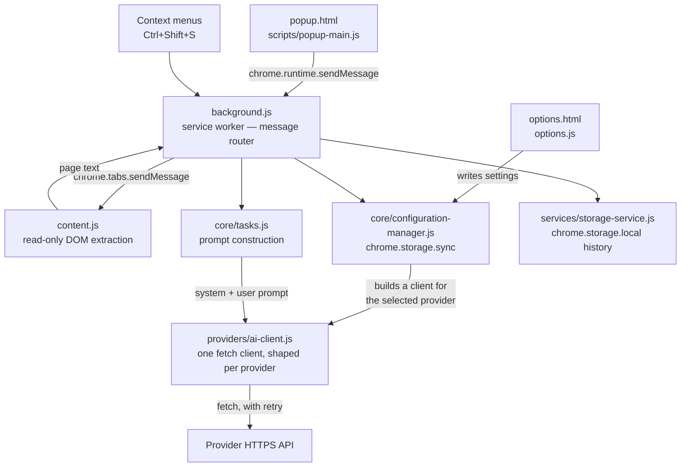
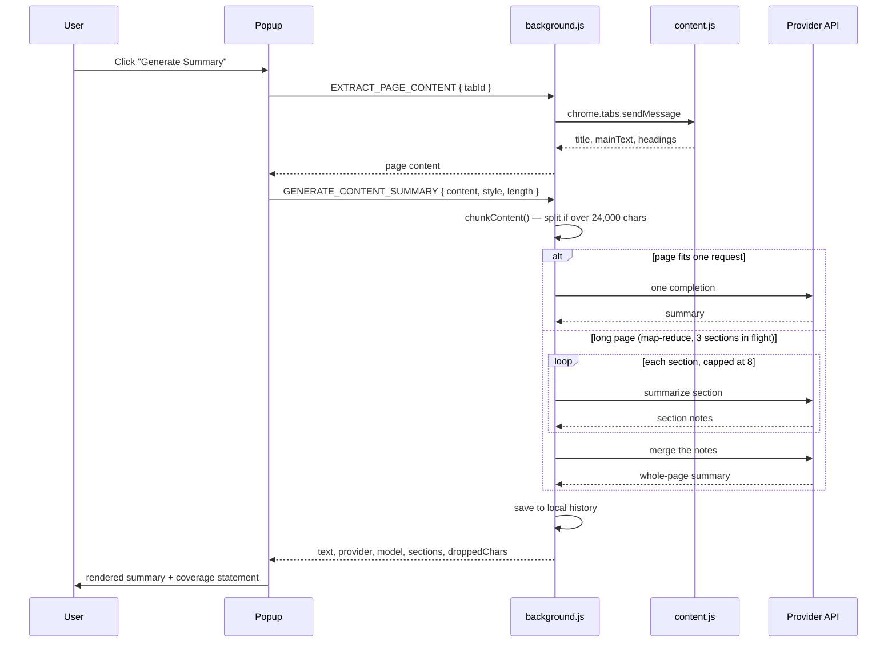

# Development Guide

This guide provides detailed information for developers working on the GenAI Browser Tool extension.

## Architecture Overview

Every AI call originates in the service worker. The popup and the options page
never talk to a provider, and the content script has no network access at all —
so there is exactly one place where a request can be shaped, retried, or leak a
key.



### Request lifecycle: one summary



A failure at any provider step is returned with its own message and an error
code (`MISSING_API_KEY`, `AUTH_ERROR`, `TIMEOUT`, …). Nothing degrades into a
plausible-looking fake result, and a section that fails after retries fails the
whole summary rather than producing a partial one presented as complete.

## Source map

| File                               | Responsibility                                                                                                                   |
| ---------------------------------- | -------------------------------------------------------------------------------------------------------------------------------- |
| `background.js`                    | `BackgroundService`: registers listeners synchronously, routes messages, runs AI tasks, and handles menus, commands, and cleanup |
| `providers/ai-client.js`           | `AIClient` and `PROVIDERS`: provider-specific HTTPS requests, response parsing, retries, and timeouts                            |
| `core/tasks.js`                    | Prompt construction, content fencing, chunking, and response parsing                                                             |
| `core/configuration-manager.js`    | Settings defaults and persistence; constructs a client for the selected provider                                                 |
| `content.js`                       | Reads page text, metadata, links, images, and selection without modifying the page                                               |
| `scripts/popup-main.js`            | Popup controls and escaped result rendering                                                                                      |
| `options.js`                       | Provider selection, keys, model overrides, appearance, and feature settings                                                      |
| `services/storage-service.js`      | Local summary and conversation history                                                                                           |
| `services/notification-manager.js` | Desktop notifications for background actions                                                                                     |

The selected provider is explicit. `ConfigurationManager.createAIClient()` either
constructs that provider's `AIClient` or reports a missing key. Default models and
wire formats live in `PROVIDERS`; there is no provider scoring or automatic
fallback. See [the provider client](../providers/ai-client.js) before adding an API.

## Message contract

Extension pages send `{ actionType, requestId, payload }` through
`chrome.runtime.sendMessage`. `requestId` is optional and echoed in the response.
`validateMessage()` requires a non-empty action string and this extension's sender
ID. The router rejects unsupported actions.

| Action                                                            | Input / result                                                                     |
| ----------------------------------------------------------------- | ---------------------------------------------------------------------------------- |
| `GENERATE_CONTENT_SUMMARY`                                        | `content`, `summaryType`, `targetLength`; returns summary and coverage information |
| `ANSWER_CONTEXTUAL_QUESTION`                                      | `question`, `context`, optional `conversationHistory`; returns answer              |
| `TRANSLATE_CONTENT`                                               | `text`, `targetLanguage`, optional `sourceLanguage`                                |
| `ANALYZE_SENTIMENT`                                               | `text`; returns sentiment and reason                                               |
| `EXTRACT_KEY_INSIGHTS`, `GENERATE_SMART_TAGS`, `EXTRACT_ENTITIES` | `text`; returns the requested analysis                                             |
| `EXTRACT_PAGE_CONTENT`                                            | `tabId`, falling back to the sender tab; returns content-script extraction         |
| `GET_USER_PREFERENCES`, `UPDATE_USER_PREFERENCES`                 | Read settings or merge a settings payload                                          |
| `GET_PROVIDER_STATUS`                                             | Configured status for the selected provider and each provider key                  |
| `GET_HISTORY`                                                     | Saved summaries and conversations                                                  |
| `EXPORT_USER_DATA`                                                | Schema-v2 object containing settings without API keys and saved history            |

Success responses contain `{ success: true, data, requestId, processingTime }`.
Failures contain `{ success: false, error, errorCode, requestId, processingTime }`.
The popup passes an explicit tab ID because popup messages have no `sender.tab`.
The content script uses its separate `{ action: 'extractContent' }` protocol.

## Storage and security

Settings live in `chrome.storage.sync.user_preferences`, including `apiKeys`,
`models`, `preferredProvider`, summary preferences, theme, and feature flags.
API keys are plaintext at the storage API level and sync with the browser profile.
They are sent only to the selected provider in HTTPS headers and excluded from
exports. See [SECURITY.md](SECURITY.md) for the trust boundaries.

History lives in `chrome.storage.local` under `genai_summary_history` (up to 1,000
entries) and `genai_conversation_history` (up to 500). A daily alarm removes entries
older than 90 days; entries without timestamps are retained. Settings have one
reader/writer, `ConfigurationManager`; history belongs to `StorageService`.

Model output is escaped before the popup's small Markdown subset is applied.
Page text is fenced as untrusted data. Questions are limited to 1,000 characters;
single-request tasks use at most 24,000 page characters. Summaries can process up
to eight sections with three section requests in flight, then merge their notes.
There is no response cache, telemetry backend, or production bundle.

## Local validation

Use Node >=20.19 and npm >=10, as declared in [package.json](../package.json).

```bash
npm ci
npm run verify
npm run test:coverage
npx playwright install chromium
npm run test:e2e
npm audit --audit-level=high
```

Vitest imports the shipped controllers and mocks `chrome.*` and provider fetches.
Coverage includes all shipped JavaScript; the global branch threshold is 78%,
with a separate 75% floor for `background.js`. Other thresholds are in
[vitest.config.js](../vitest.config.js).

Playwright loads the actual extension in persistent Chromium contexts. Fixture
pages and provider responses are intercepted. A real toolbar-icon click granting
`activeTab` remains a manual release check; intercepted tests do not demonstrate
live provider credentials, model availability, or output quality.

## Pull requests and packaging

CI runs lint, typechecking, and coverage on Node 20/22/24; Node 22 also runs the
dependency audit. Browser tests run before the package job.

The PR-base job rejects a non-default base branch already contained in the default
branch. Retarget the PR at the default branch when this fails. The check runs on
opening, reopening, head updates, and edits (including retargeting). It checks Git
ancestry at workflow time; squash/rebase equivalence and future base merges are
not continuously monitored. Tests in `tests/ci/pr-base.test.js` exercise the guard
against temporary Git histories.

The repository root is the loadable extension. Load it unpacked at
`chrome://extensions`, then reload after source edits. Legacy `dist/` and `build/`
output are ignored by Git and ESLint and can be left in an older checkout.

The CI ZIP explicitly includes `manifest.json`, the runtime root JavaScript and
HTML/CSS files, `assets/`, `core/`, `providers/`, `scripts/`, `services/`, `styles/`,
`utils/`, `README.md`, and `LICENSE`. Keep that list in
[ci.yml](../.github/workflows/ci.yml) current when adding runtime files. CI uploads
the ZIP as an Actions artifact; Chrome Web Store publishing is a separate release
step. Install and configure the unpacked extension using [README.md](../README.md).

For consolidation decisions and verification evidence, see
[INTEGRATION-REVIEW.md](INTEGRATION-REVIEW.md).
