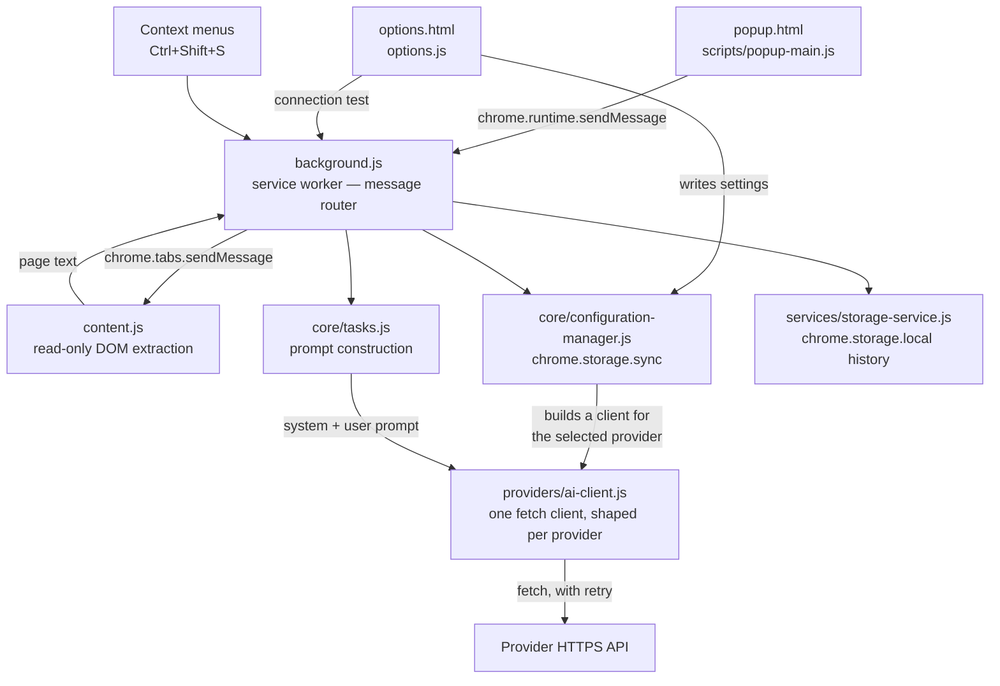
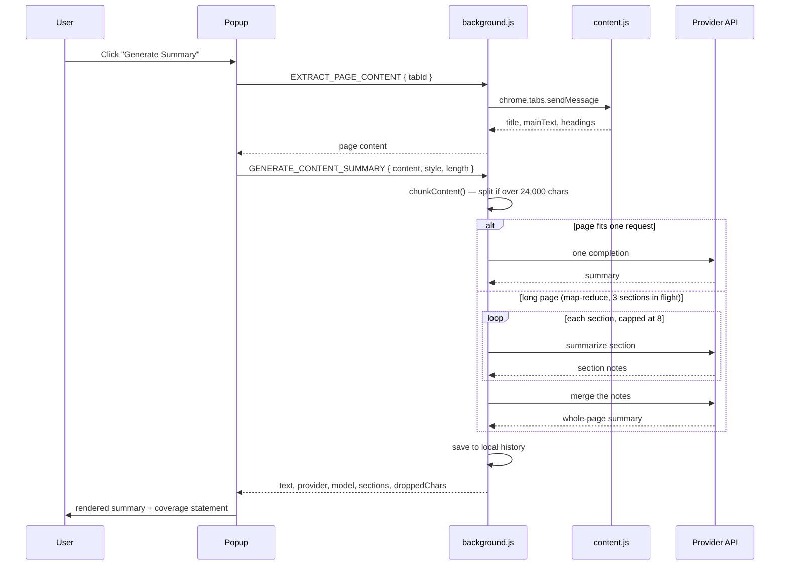
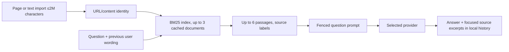

# Development Guide

This guide provides detailed information for developers working on the GenAI Browser Tool extension.

## Architecture Overview

Every AI call originates in the service worker. The popup and the options page
never talk to a provider, and the content script has no network access at all —
so there is exactly one place where a request can be shaped, retried, or leak a
key.



### Request lifecycle: one summary



A failure at any provider step is returned with its own message and an error
code (`MISSING_API_KEY`, `AUTH_ERROR`, `TIMEOUT`, …). Nothing degrades into a
plausible-looking fake result, and a section that fails after retries fails the
whole summary rather than producing a partial one presented as complete.

## Source map

| File                               | Responsibility                                                                                                                   |
| ---------------------------------- | -------------------------------------------------------------------------------------------------------------------------------- |
| `background.js`                    | `BackgroundService`: registers listeners synchronously, routes messages, runs AI tasks, and handles menus, commands, and cleanup |
| `providers/ai-client.js`           | `AIClient` and `PROVIDERS`: provider-specific HTTPS requests, response parsing, retries, and timeouts                            |
| `core/tasks.js`                    | Prompt construction, content fencing, chunking, and response parsing                                                             |
| `core/document.js`                 | Shared 2,000,000-character limit and URL/content SHA-256 identity                                                                |
| `core/retrieval.js`                | Local BM25 passage indexing, ranking, and source excerpts                                                                        |
| `core/configuration-manager.js`    | Settings defaults and persistence; constructs a client for the selected provider                                                 |
| `content.js`                       | Reads page text, metadata, links, images, and selection without modifying the page                                               |
| `scripts/popup-main.js`            | Popup/workspace controls, text import, scoped restoration, and escaped result rendering                                          |
| `options.js`                       | Provider selection, keys, model overrides, appearance, and feature settings                                                      |
| `services/storage-service.js`      | Local summary and conversation history                                                                                           |
| `services/notification-manager.js` | Desktop notifications for background actions                                                                                     |

The selected provider is explicit. `ConfigurationManager.createAIClient()` either
constructs that provider's `AIClient` or reports a missing key. Default models and
wire formats live in `PROVIDERS`; there is no provider scoring or automatic
fallback. See [the provider client](../providers/ai-client.js) before adding an API.

## Message contract

Extension pages send `{ actionType, requestId, payload }` through
`chrome.runtime.sendMessage`. `requestId` is optional and echoed in the response.
`validateMessage()` requires a non-empty action string and this extension's sender
ID. The router rejects unsupported actions.

| Action                                                            | Input / result                                                                                                                        |
| ----------------------------------------------------------------- | ------------------------------------------------------------------------------------------------------------------------------------- |
| `GENERATE_CONTENT_SUMMARY`                                        | `content`, `summaryType`, `targetLength`; returns summary and coverage information                                                    |
| `ANSWER_CONTEXTUAL_QUESTION`                                      | `question`, `context`, optional `conversationHistory`, `url`, `title`; returns answer, sources, and retrieval coverage                |
| `TRANSLATE_CONTENT`                                               | `text`, `targetLanguage`, optional `sourceLanguage`                                                                                   |
| `ANALYZE_SENTIMENT`                                               | `text`; returns sentiment and reason                                                                                                  |
| `EXTRACT_KEY_INSIGHTS`, `GENERATE_SMART_TAGS`, `EXTRACT_ENTITIES` | `text`; returns the requested analysis                                                                                                |
| `EXTRACT_PAGE_CONTENT`                                            | `tabId`, falling back to the sender tab; returns content-script extraction                                                            |
| `GET_USER_PREFERENCES`, `UPDATE_USER_PREFERENCES`                 | Read settings or merge a settings payload                                                                                             |
| `GET_PROVIDER_STATUS`                                             | Configured status for the selected provider and each provider key                                                                     |
| `TEST_PROVIDER_CONNECTION`                                        | Entered `provider`, `apiKey`, optional `model`; one 16-token request, 10-second timeout, zero retries; returns model, never saves key |
| `GET_DOCUMENT_HISTORY`                                            | `url`, `content`; returns one summary, up to 30 exchanges for that identity, and `memoryEnabled`                                      |
| `CLEAR_DOCUMENT_CHAT`                                             | `url`, `content`; removes only matching exchanges; returns count                                                                      |
| `GET_HISTORY`                                                     | Saved summaries and conversations                                                                                                     |
| `EXPORT_USER_DATA`                                                | Schema-v2 object containing settings without API keys and saved history                                                               |

Success responses contain `{ success: true, data, requestId, processingTime }`.
Failures contain `{ success: false, error, errorCode, requestId, processingTime }`.
The popup passes an explicit tab ID because popup messages have no `sender.tab`.
The content script uses its separate `{ action: 'extractContent' }` protocol.

## Storage and security

Settings live in `chrome.storage.sync.user_preferences`, including `apiKeys`,
`models`, `preferredProvider`, summary preferences, source/target languages, theme,
and feature flags.
API keys are plaintext at the storage API level and sync with the browser profile.
They are sent only to the selected provider in HTTPS headers and excluded from
exports. See [SECURITY.md](SECURITY.md) for the trust boundaries.

History lives in `chrome.storage.local` under `genai_summary_history` (up to 1,000
entries) and `genai_conversation_history` (up to 500). A daily alarm removes entries
older than 90 days; entries without timestamps are retained. Settings have one
reader/writer, `ConfigurationManager`; history belongs to `StorageService`.

Model output is escaped before the popup's small Markdown subset is applied.
Page text is fenced as untrusted data. Questions are limited to 1,000 characters;
single-request tasks use at most 24,000 context characters. Summaries can process
up to eight sections with three section requests in flight, then merge their notes.
There is no telemetry backend or production bundle.

### Document retrieval, cache, and memory

The worker hashes URL plus trimmed text to identify a document. A changed page or
different URL starts a new thread. Older unscoped history remains exportable but
is not restored into a page. Full text imports and indexes are not persisted.



Passages are at most 2,800 characters with 200-character overlap. Retrieval is
lexical; no-match queries sample across the document. It does not guarantee
semantic recall or whole-book coverage. The index cache evicts the oldest inserted
document at three entries and is lost on worker suspension. The next question
rebuilds it. Restored exchanges use at most 30 turns; prompts use the bounded
recent conversation in `core/tasks.js`.

Summary cache keys include `summary-v1`, identity, provider, model, style, and
length. Bump the cache version if summary prompt meaning changes. The request
lifecycle above is skipped on a matching saved result. Save-history off disables
new saves, summary cache reuse, and restoration; it does not erase past records.
The preference is read again before persisting an in-flight result.

Storage read-modify-write operations are serialized per history key in the single
worker. Clear-chat and daily cleanup use the same queues. A failed mutation read
propagates rather than overwriting history with an empty list. Read-only history
access retains its logged fallback behavior.
Generated summaries are stored once as `summary`; `text` is reconstructed for the
response contract. If a history write fails (including storage quota), summary
and chat results still reach the UI with a visible warning to copy the result.
No second AI request is made just to retry persistence.

`popup.html?workspace=1&tabId=123` uses an explicit source tab; ordinary popup
startup queries the active tab. Workspace text/Markdown import validates an 8 MB
file limit and the shared character limit. Import and extraction trigger no AI
request. Imported material uses a `local-document:` filename identity plus its
content hash. File content is read only after the user chooses it.

## Local validation

Use Node >=20.19 and npm >=10, as declared in [package.json](../package.json).

```bash
npm ci
npm run verify
npm run test:coverage
npx playwright install chromium
npm run test:e2e
npm audit --audit-level=high
npm run benchmark:retrieval
```

Vitest imports the shipped controllers and mocks `chrome.*` and provider fetches.
Coverage includes all shipped JavaScript; the global branch threshold is 78%,
with a separate 75% floor for `background.js`. Other thresholds are in
[vitest.config.js](../vitest.config.js).

Playwright loads the actual extension in persistent Chromium contexts. Fixture
pages and provider responses are intercepted. A real toolbar-icon click granting
`activeTab` remains a manual release check; intercepted tests do not demonstrate
live provider credentials, model availability, or output quality.

## Pull requests and packaging

CI runs lint, typechecking, and coverage on Node 20/22/24; Node 22 also runs the
dependency audit. Browser tests run before the package job.

The workflow selects `ubuntu-26.04` explicitly and pins action release commits.
Action runtimes are separate from the Node versions tested by the project.
Checkout credentials are not retained after checkout; the ancestry guard uses
the full fetched history. npm caching uses `package-lock.json` explicitly, and
the dependency-free guard disables automatic package-manager caching.
See [migration decisions and validation](ci-modernization-evidence.md) before
updating these pins. Codecov remains optional; a green job alone does not prove
that coverage reached the service.

The PR-base job rejects a non-default base branch already contained in the default
branch. Retarget the PR at the default branch when this fails. The check runs on
opening, reopening, head updates, and edits (including retargeting). It checks Git
ancestry at workflow time; squash/rebase equivalence and future base merges are
not continuously monitored. Tests in `tests/ci/pr-base.test.js` exercise the guard
against temporary Git histories.

The repository root is the loadable extension. Load it unpacked at
`chrome://extensions`, then reload after source edits. Legacy `dist/` and `build/`
output are ignored by Git and ESLint and can be left in an older checkout.

The CI ZIP explicitly includes `manifest.json`, the runtime root JavaScript and
HTML/CSS files, `assets/`, `core/`, `providers/`, `scripts/`, `services/`, `styles/`,
`utils/`, `README.md`, and `LICENSE`. Keep that list in
[ci.yml](../.github/workflows/ci.yml) current when adding runtime files. CI uploads
the ZIP as an Actions artifact; Chrome Web Store publishing is a separate release
step. Install and configure the unpacked extension using [README.md](../README.md).

For consolidation decisions and verification evidence, see
[INTEGRATION-REVIEW.md](INTEGRATION-REVIEW.md).
For product scope, research, and retrieval measurements, see
[product/PRODUCT.md](product/PRODUCT.md) and [product/RESEARCH.md](product/RESEARCH.md).
