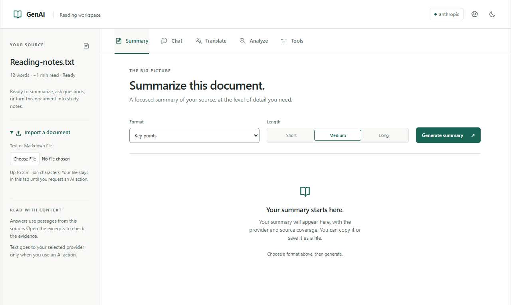
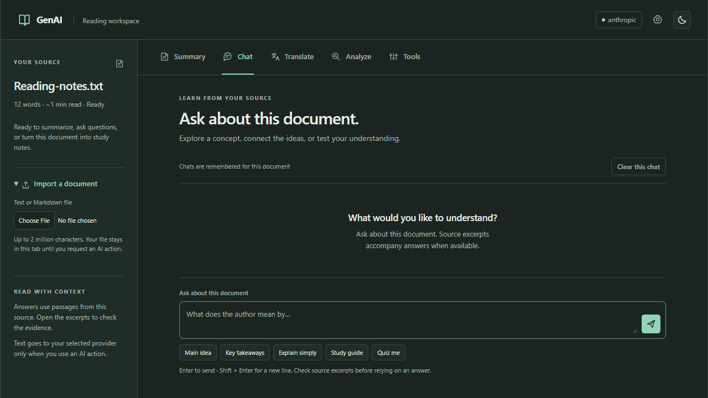

# Reading interface: decisions and verification

The [#36 milestone](https://github.com/aaron-seq/GenAI-Browser-Tool/issues/36)
replaces the gradient/emoji interface with a quiet reading desk. The source stays
beside the five tools on wide screens and above them on narrow screens. Task
labels describe actions; provider, memory, coverage, and source excerpts stay visible.

## Design decisions

- Neutral surfaces, a restrained teal accent, system fonts, and local inline SVG
  icons. No font requests, runtime dependency, or permission was added.
- Main content has a bounded reading width. The chat composer fits the tested
  1280 × 720 desktop view; conversation history scrolls separately.
- Short study labels retain their full prompts in `data-prompt`. Import stays
  available while using another task. Existing history and provider routes are reused.
- Native radios remain focusable, with a visible group focus indicator. Tabs
  expose selected/hidden states and follow the [WAI tabs pattern](https://www.w3.org/WAI/ARIA/apg/patterns/tabs/).
  Focus remains in the tab list; Tab enters the selected panel.
- [Visible focus](https://www.w3.org/WAI/WCAG22/Understanding/focus-visible.html),
  reduced motion, forced colors, and light/dark tokens have explicit treatment.
  Calculated muted-text contrast against the page is 5.22:1 light / 7.55:1 dark;
  input-boundary contrast is 3.21:1 / 4.41:1. This is a token check, not a complete
  accessibility conformance audit or a screen-reader test.

The [Comet product page](https://www.perplexity.ai/comet) provides context for
page-based assistance and learning. It was inspected as a product reference;
no comparative usability, live-model quality, or latency test was performed.

## Verification — 23 October 2026

Local Windows / Node 22.18.0 / npm 11.6.2 results:

| Command / check                                                                                                     | Observed result                                                                                       |
| ------------------------------------------------------------------------------------------------------------------- | ----------------------------------------------------------------------------------------------------- |
| `npm run verify` on main b584f4e                                                                                    | Lint/typecheck and 297 tests pass before changes.                                                     |
| `npx vitest run tests/popup/interface.test.js -t 'selected tab\|complete study prompt'` on test-only commit f6f9e2b | Both new cases fail before implementation.                                                            |
| `npx playwright test tests/e2e/reading-interface.spec.js` before implementation                                     | Cannot locate the hidden summary radio through its accessible role; fails.                            |
| `npm run lint -- --max-warnings 0`; `npm run typecheck`                                                             | Pass.                                                                                                 |
| `npm run test:coverage`                                                                                             | 299 tests pass; 94.53% statements, 83.73% branches, 94.71% functions, 96.70% lines. Floors unchanged. |
| `npm run test:e2e`                                                                                                  | 19 real-Chromium tests pass; provider responses are intercepted.                                      |
| Final affected popup tests and two workspace/interface browser tests                                                | Pass after copy/contrast/layout refinements.                                                          |
| `npm audit --audit-level=high`                                                                                      | Zero vulnerabilities reported.                                                                        |

The [unit tests](../../tests/popup/interface.test.js) verify tab semantics/focus,
full study prompts, empty/result transitions, and existing task behavior. The
[browser test](../../tests/e2e/reading-interface.spec.js) checks native radio
keyboard operation, panel focus order, all five tabs at 768/400/320px widths,
theme switching, source extraction in the 400px popup, and horizontal overflow.
Screenshots were generated by these browser tests and visually inspected. Opening a source
excerpt scrolls it into view within the conversation. A new browser assertion failed
before that adjustment (viewport intersection 0) and passes with the excerpt fully visible.

Global branch coverage is 83.73% versus the prior published 84.05%; the added UI
branches are not all exercised by the unit suite. The source-scroll callback is
verified in the real browser test. Existing tests and thresholds are preserved.

No provider speed improvement is claimed. Native toolbar activation, real
screen readers, Edge, OS notifications, real browser zoom, and live-model quality
were not tested. The settings/onboarding design remains in
[#37](https://github.com/aaron-seq/GenAI-Browser-Tool/issues/37); the separately
reproduced notification read-failure gap is in
[#38](https://github.com/aaron-seq/GenAI-Browser-Tool/issues/38).
